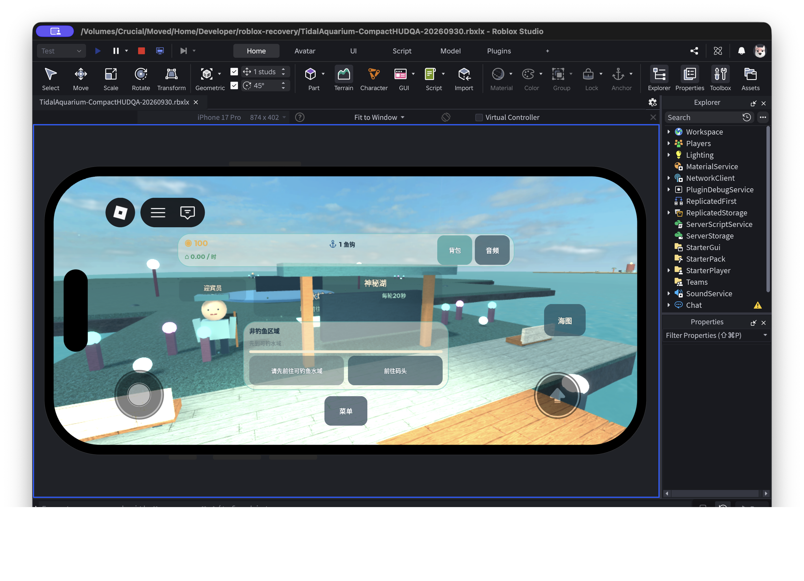
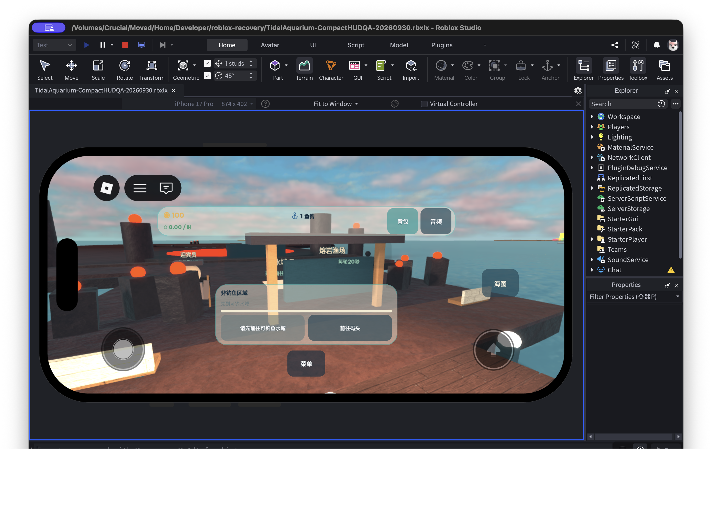

# Tidal Aquarium: adding fish without breaking the loop

Adding 28 themed fish meant keeping their names, rarity, artwork and gameplay in sync. Public source defines four themed zones in `ThemeContent.luau`: seven species each with weights, rarity and template keys. `Config` appends them to the original 42; `ArtCatalog` resolves each to an imported template.

Code and tests check 28 themed species, 9 zones, 70 total, one fish per rarity and unique template mappings. Public comments say derivatives retain source mesh and texture while adding geometry.

Historical Studio QA on September 27 logged the fishing loop, nine-zone travel, 70/70 presentation coverage and a 20-second two-hook cycle. The September 30 scene pass checked walkable centers, cast water, boat clearance and compact HUD bounds. Development time is unrecorded.

`make test` and `make build` still do not replace a fresh Studio run, physical touch, multiplayer and cloud-save checks. Next I would rerun those on the public commit. Try it: open `build/TidalAquarium.rbxlx`, click Play, merge three matching fish, place one in the aquarium, then fish at the dock. Source: https://github.com/Angelov1314/tidal-aquarium. The source is all rights reserved; the snapshot permits non-commercial demo evaluation, and third-party terms remain separate.
